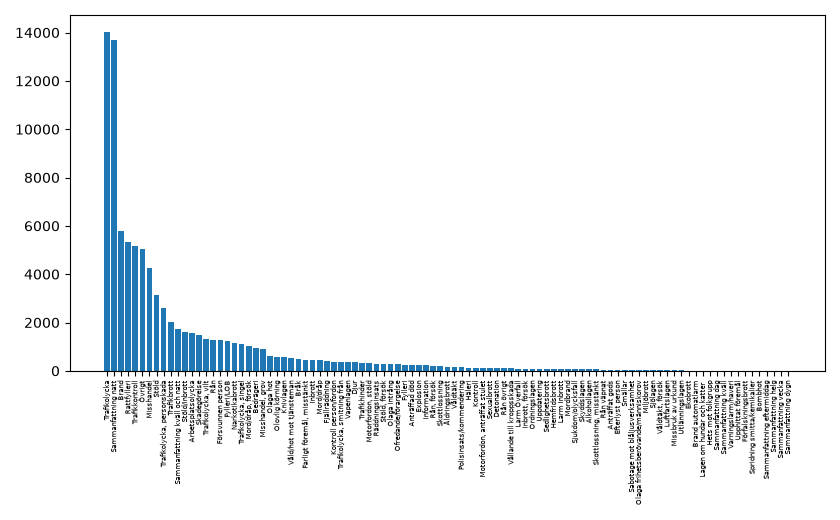
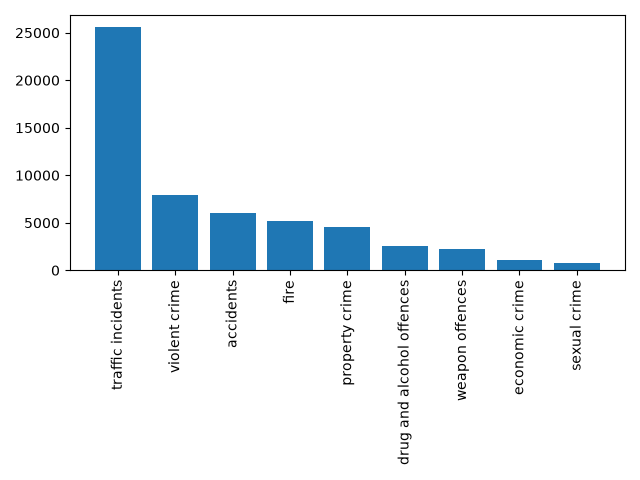

# Crime and Incident Forecasting

Forecasting crime and incident risk using events reported by the Swedish Police Agency.

## About

This is an unfinished and ongoing project. The idea is use events reported by the Swedish Police Agency from their events API [https://polisen.se/api/events] along with other features to forecast the risk of crime and incidents.

One potential method could be to use daily weather forecasts to predict the risk using a machine learning model. For example, the model could be trained on historical weather and events and then predict whether it "thinks" that there will be a *lower*, *normal* or *higher* risk of certain events given the weather forecasts for the next days.

## Events

The API only retrieves recent events. However, a public archive of events is available at [https://github.com/dnouri/polisen-se-events-history/] thanks to Daniel Nouri.

There are historically 95+ categories of events, which are too fine-grained for the goal of this project.

Instead, the event types will be filtered and mapped to broader and more useful classes using semantic embeddings of the types and the descriptions provided in each event.

